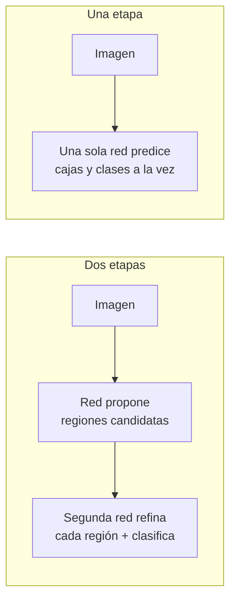

# 2. Detección de objetos

**Objetivo:** entender qué produce un detector, cómo se compara una caja predicha con una real (IoU), cómo se eliminan duplicados (NMS) y cómo los detectores modernos como YOLO deciden *dónde* mirar.

## 2.1 Clasificar, detectar, segmentar

| Tarea | Pregunta | Salida |
| --- | --- | --- |
| **Clasificación** | ¿Qué hay en la imagen? | una etiqueta para toda la imagen |
| **Detección** | ¿Qué objetos hay y **dónde**? | lista de (caja, clase, confianza) |
| **Segmentación** | ¿Qué píxeles son de cada objeto? | una máscara por objeto |

Nuestro proyecto es **detección**. Para una imagen con 11 vehículos (el promedio en nuestro dataset: 11.1 cajas por imagen) el modelo debe devolver ≈ 11 cajas, cada una con su clase y un número entre 0 y 1 llamado **confianza** (*score*).

## 2.2 Cajas delimitadoras (bounding boxes)

Una caja horizontal (**HBB**, *horizontal bounding box*) se describe de varias formas equivalentes:

| Formato | Valores | Usado por |
| --- | --- | --- |
| `xyxy` | \((x_1,y_1,x_2,y_2)\): esquinas superior-izquierda e inferior-derecha | muchas librerías |
| `xywh` | \((c_x,c_y,w,h)\): centro, ancho y alto | YOLO (internamente) |
| normalizado | lo anterior dividido por el ancho/alto de la imagen, en \([0,1]\) | archivos de etiquetas YOLO |

!!! warning "Trampa común"
    El eje **y crece hacia abajo** en una imagen. Esto afecta a la interpretación de los ángulos (capítulo 4).

## 2.3 IoU: cuánto se parecen dos cajas

La **IoU** (*Intersection over Union*, índice de Jaccard) mide el solapamiento entre una caja predicha \(A\) y una real \(B\):

\[
\text{IoU}(A,B)=\frac{\text{área}(A\cap B)}{\text{área}(A\cup B)}=\frac{\text{área}(A\cap B)}{\text{área}(A)+\text{área}(B)-\text{área}(A\cap B)}
\]

Va de 0 (sin contacto) a 1 (idénticas).

!!! example "Ejemplo numérico"
    Dos cajas de 4 × 4 (área 16 cada una).

    - Desplazada 1 unidad en x: intersección \(3\times4=12\); unión \(16+16-12=20\); **IoU = 0.60**.
    - Desplazada 2 unidades: intersección \(2\times4=8\); unión 24; **IoU = 0.33**.
    - Desplazada 2 en x y 2 en y: intersección \(2\times2=4\); unión 28; **IoU = 0.14**.

    Un desplazamiento de solo la **mitad del tamaño** de la caja ya baja la IoU a 0.33. Con objetos pequeños, errores de un par de píxeles destruyen la IoU. Un auto de 10 px de lado en la entrada del modelo: un error de 2 px ≈ 20 % de su tamaño.

Una predicción se considera **correcta** si su IoU con una caja real supera un **umbral** (típicamente 0.50). Ese umbral es central en las [métricas](03-metricas.md).

## 2.4 Qué predice una red de detección

La red recibe una imagen y devuelve **muchísimas** cajas candidatas, la mayoría basura o duplicadas. Cada candidata trae: la caja, un puntaje por clase (¿es auto? ¿moto?…) y, según el diseño, un puntaje de "hay un objeto".

### Por qué hay duplicados

Un auto real es "visto" por varias celdas vecinas de la red; cada una propone su propia caja sobre el mismo auto. Si las dejamos, un auto se cuenta 5 veces.

## 2.5 NMS: Non-Maximum Suppression

Algoritmo para quedarse con una sola caja por objeto:

1. Descarta cajas con confianza < `conf` (p. ej. 0.25).
2. Ordena el resto por confianza, de mayor a menor.
3. Toma la mejor; **elimina** todas las de su misma clase con IoU > umbral NMS (p. ej. 0.7) respecto a ella.
4. Repite con la mejor que quede, hasta terminar.

!!! example "Ejemplo numérico"
    Tres cajas de la clase *car*: A (0.90), B (0.80), C (0.60). IoU(A,B) = 0.70 (mismo auto), IoU(A,C) = 0.10, IoU(B,C) = 0.20, umbral NMS = 0.5.

    - Se toma A. B tiene IoU 0.70 > 0.5 con A → se elimina.
    - Se toma C (IoU con A = 0.10 < 0.5 → sobrevive): es otro auto.
    - Resultado: {A, C}.

!!! warning "Trampa común"
    En tráfico denso, dos autos pegados pueden tener IoU alta entre sí y NMS podría borrar uno **real**. Las cajas **orientadas** reducen ese problema porque ajustan mejor y solapan menos (capítulo 4).

## 2.6 Dos familias de detectores

| | Dos etapas (Faster R-CNN, Oriented R-CNN) | Una etapa (YOLO, SSD, RetinaNet) |
| --- | --- | --- |
| Idea | primero *proponer*, luego *refinar* | predecir todo de una vez |
| Precisión | tradicionalmente mayor | hoy comparable |
| Velocidad | más lenta | más rápida |
| Uso típico | investigación, precisión máxima | tiempo real, borde |

YOLO significa *You Only Look Once*: la imagen pasa **una sola vez** por la red.

## 2.7 Anchors vs. anchor-free

Los primeros detectores de una etapa usaban **anchors**: cajas de tamaños/proporciones predefinidos colocadas en cada celda; la red solo predecía pequeñas correcciones. Eran sensibles a elegir bien esos tamaños.

Los modelos recientes, incluido YOLO11, son **anchor-free**: cada punto de la cuadrícula predice directamente las distancias desde sí mismo hasta los lados de la caja. Menos hiperparámetros que ajustar.

### Cuadrículas multiescala

La red produce predicciones en tres escalas (*stride* 8, 16 y 32):

| `imgsz` | Cuadrícula stride 8 | 16 | 32 | Candidatas totales |
| --- | --- | --- | --- | --- |
| 544 | 68×68 | 34×34 | 17×17 | \(4624+1156+289=\mathbf{6\,069}\) |
| 640 | 80×80 | 40×40 | 20×20 | \(6400+1600+400=\mathbf{8\,400}\) |

- Escala fina (stride 8): objetos **pequeños**.
- Escala gruesa (stride 32): objetos **grandes**.

Esta combinación de escalas se llama pirámide de características (**FPN/PAN**, ver [capítulo 5](05-yolo11.md)).

!!! tip "En nuestro proyecto"
    Cada imagen produce 6 069 u 8 400 candidatas, y NMS las reduce a ≈ 11. Es también lo que consume tiempo en la Pi: el **postproceso** (NMS) tomó 4.2 ms de los 300 ms totales; la red, 255 ms.

## 2.8 Cómo se entrena un detector

Para cada imagen de entrenamiento hay que decidir **cuáles de las 6 069 candidatas deben encargarse de cada vehículo real**. Es la **asignación de etiquetas** (*label assignment*). YOLO11 usa **TAL** (*Task-Aligned Assigner*): para cada objeto real elige las candidatas cuyo centro cae dentro de él y que combinan mejor *buena clase predicha* y *buena IoU*.

La **pérdida** total suma tres (o cuatro, con ángulo) términos:

| Término | Qué castiga |
| --- | --- |
| **box loss** | caja predicha lejos de la real (aquí basada en IoU probabilística, ver cap. 4) |
| **cls loss** | clase incorrecta o confianza mal calibrada (entropía cruzada binaria) |
| **dfl loss** | imprecisión en la distribución de bordes (*Distribution Focal Loss*) |
| **angle loss** | ángulo mal estimado (en nuestro `results.csv` es la columna `train/angle_loss`) |

!!! tip "En nuestro proyecto"
    Abre `results/finetune_70ep_640px/runs/dataset_2500/results.csv`: verás las cuatro pérdidas por época para train y val. Una curva de val que baja y luego sube indica sobreajuste.

## 2.9 El fondo (*background*)

De las 6 069 candidatas, miles corresponden a "nada" (calle, edificios, árboles). El modelo también debe aprender a **no** detectar: esto es lo que la matriz de confusión del paper llama la fila/columna `background`. En nuestro subconjunto de 2 500 imágenes, 163 (6.5 %) no contienen ningún vehículo anotado: sirven como ejemplos negativos.

## Resumen

- Un detector devuelve cajas con clase y confianza; IoU las compara; NMS elimina duplicados.
- YOLO es de una etapa y anchor-free, con 3 escalas de predicción.
- Entrenar requiere asignar candidatas a objetos reales y minimizar varias pérdidas.
- Los objetos pequeños son difíciles porque quedan menores que una celda y porque la IoU es muy sensible a errores de unos píxeles.

!!! question "Comprueba que entendiste"
    1. Dos cajas de 10×10 solapan en un cuadrado de 5×5. ¿IoU?
    2. ¿Por qué NMS puede eliminar un vehículo real?
    3. ¿Cuántas candidatas produce el modelo a 640 px?
    4. ¿Qué significa que una red sea *anchor-free*?

    ??? success "Respuestas"
        1. Intersección 25; unión \(100+100-25=175\); IoU \(=0.143\).
        2. Si dos vehículos reales están tan juntos que sus cajas solapan más que el umbral NMS, el de menor confianza se descarta como "duplicado".
        3. 8 400.
        4. Que no usa cajas de referencia predefinidas: cada punto predice directamente las distancias a los lados de la caja.

## Para profundizar

- Redmon et al., *You Only Look Once: Unified, Real-Time Object Detection*, CVPR 2016 (referencia [5] del paper).
- Li et al., *TOOD: Task-aligned One-stage Object Detection*, ICCV 2021 (de donde viene TAL).
- Li et al., *Generalized Focal Loss*, NeurIPS 2020 (de donde viene DFL).
- CS231n, módulo de detección.
