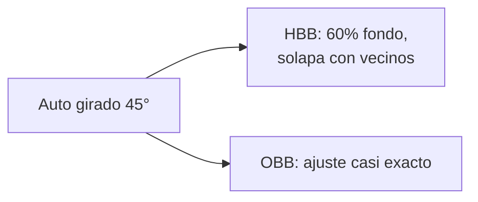

# 4. Cajas orientadas (OBB)

**Objetivo:** entender por qué existen las cajas orientadas, cómo se representan, de dónde sale la ecuación (1) del paper, y por qué predecir ángulos es un problema difícil que se resuelve con una trampa elegante (distribuciones gaussianas).

## 4.1 El problema de la caja horizontal

Una caja horizontal (HBB) siempre tiene lados paralelos a los ejes. Si el objeto está girado, la caja que lo contiene incluye mucho fondo.

!!! example "Ejemplo numérico: un auto girado 45°"
    Auto de \(w=90\) × \(h=35\) px, girado \(\theta=45^\circ\). La caja horizontal mínima que lo contiene mide:

    \[
    W_{HBB}=w|\cos\theta|+h|\sin\theta|=(90+35)(0.7071)=88.4,\qquad H_{HBB}=w|\sin\theta|+h|\cos\theta|=88.4
    \]

    Área HBB \(=88.4^2=7\,813\) px²; área del auto \(=90\times35=3\,150\) px². **El 60 % de la caja es fondo.** Además, dos autos paralelos y girados 45° tienen HBB que solapan mucho, aunque los autos no se toquen: NMS puede borrar uno.

Una **caja orientada** (**OBB**, *oriented bounding box*) añade el ángulo de rotación y ajusta el rectángulo al objeto. Nació en imágenes aéreas (aviones, barcos, vehículos vistos desde arriba), por eso el benchmark de referencia es **DOTA**.

## 4.2 Representaciones

Una OBB se describe de varias formas equivalentes:

| Representación | Números | Dónde se usa |
| --- | --- | --- |
| **Centro-tamaño-ángulo** \((c_x,c_y,w,h,\theta)\) | 5 | nuestro CSV de anotaciones (ángulo en **grados**); salida interna de YOLO-OBB (ángulo en radianes) |
| **4 esquinas** \((x_1,y_1,\dots,x_4,y_4)\) | 8 | archivos de etiquetas YOLO-OBB y DOTA |

El paso del primero al segundo es la **ecuación (1) del paper**.

## 4.3 De dónde sale la ecuación (1)

Partimos de un rectángulo centrado en el origen, sin girar, con esquinas locales
\((d_x,d_y)\in\{(-\tfrac w2,-\tfrac h2),(\tfrac w2,-\tfrac h2),(\tfrac w2,\tfrac h2),(-\tfrac w2,\tfrac h2)\}\).

**Rotarlo** un ángulo \(\theta\) alrededor del origen equivale a multiplicar cada esquina por la matriz de rotación:

\[
\begin{pmatrix}x'\\y'\end{pmatrix}=\begin{pmatrix}\cos\theta&-\sin\theta\\ \sin\theta&\cos\theta\end{pmatrix}\begin{pmatrix}d_x\\d_y\end{pmatrix}
\]

**Trasladarlo** al centro real \((c_x,c_y)\) suma esas coordenadas:

\[
x=c_x+d_x\cos\theta-d_y\sin\theta,\qquad y=c_y+d_x\sin\theta+d_y\cos\theta
\]

Esa es la ecuación (1). Finalmente se dividen \(x\) por el ancho de la imagen y \(y\) por el alto, y se recortan a \([0,1]\).

!!! example "Ejemplo numérico completo"
    Caja \(c_x=100,\;c_y=50,\;w=40,\;h=20,\;\theta=90^\circ\) (\(\cos=0,\ \sin=1\)):

    | Esquina local \((d_x,d_y)\) | \(x=100+0\cdot d_x-1\cdot d_y\) | \(y=50+1\cdot d_x+0\cdot d_y\) | Punto |
    | --- | --- | --- | --- |
    | \((-20,-10)\) | 110 | 30 | (110, 30) |
    | \((20,-10)\) | 110 | 70 | (110, 70) |
    | \((20,10)\) | 90 | 70 | (90, 70) |
    | \((-20,10)\) | 90 | 30 | (90, 30) |

    El resultado abarca \(x\in[90,110]\), \(y\in[30,70]\): 20 de ancho y 40 de alto. Una caja de 40×20 girada 90° es una caja de 20×40. ✔ Esto muestra algo importante: **\((w,h,\theta)\) y \((h,w,\theta+90^\circ)\) describen el mismo rectángulo**.

!!! warning "Trampa común: el eje y apunta hacia abajo"
    En imágenes, \(y\) crece hacia abajo; con la matriz anterior, un ángulo positivo gira **en sentido horario** al verlo en pantalla (al revés que en matemáticas). Si alguna vez conviertes datos de otra fuente, verifica la convención con una imagen de prueba antes de entrenar.

!!! tip "En nuestro proyecto"
    Es la función `obb_corners_normalized` en `src/swole_yolo/data.py`. Detalle sutil: recorta **cada coordenada de cada esquina por separado** a \([0,1]\). Si un vehículo cruza el borde de la imagen, las esquinas recortadas ya no forman un rectángulo perfecto. Ultralytics luego convierte las 4 esquinas a \((x_c,y_c,w,h,\theta)\) ajustando el rectángulo de área mínima, de modo que el efecto suele ser pequeño, pero **no lo hemos cuantificado**.

## 4.4 Lo que dicen nuestros datos sobre los ángulos

Sobre las 27 841 cajas del subconjunto de 2 500 imágenes:

| Hecho | Valor |
| --- | --- |
| Cajas con ángulo exactamente 0° | **60.7 %** |
| Cajas a ≤ 2° de alinearse con un eje (0°, 90°, 180°, 270°) | **81.1 %** |
| Cajas a más de 10° de un eje | **6.9 %** |
| Cajas a más de 30° de un eje | **2.1 %** |

!!! failure "Consecuencia importante para el paper"
    Cuatro de cada cinco vehículos están anotados prácticamente alineados con los ejes: en imágenes cenitales de dron, las calles y los autos estacionados quedan paralelos a los bordes. En ese régimen, una caja horizontal funcionaría casi igual. **El paper no demuestra que OBB aporte valor sobre HBB en este dataset**, solo que "funciona". Un experimento HBB vs. OBB con los mismos datos es la respuesta natural (ver [plan](../PLAN.md)). La ventaja de OBB debería concentrarse en el ~7 % de vehículos inclinados (giros, autos mal estacionados, motos).

## 4.5 Por qué es difícil predecir el ángulo

1. **Periodicidad**: \(\theta\) y \(\theta+180^\circ\) son el mismo rectángulo (un auto visto "de frente" o "de atrás" es el mismo recuadro). Una red no debería penalizar esa diferencia, pero un error de \(179^\circ\) vs. \(1^\circ\) parece enorme en una pérdida ingenua (**discontinuidad en la frontera**).
2. **Ambigüedad \((w,h)\leftrightarrow(h,w)\)**: como vimos, girar 90° e intercambiar lados da la misma caja. Hay que fijar una convención.
3. **Cajas casi cuadradas**: si \(w\approx h\), el ángulo es casi irrelevante e inestable.
4. **IoU no diferenciable**: el IoU exacto entre rectángulos girados (intersección de polígonos) es costoso y poco apto para el gradiente.

## 4.6 La solución: tratar la caja como una gaussiana (ProbIoU)

Idea: representar cada rectángulo orientado como una **distribución gaussiana 2D**:

- **Media** \(\mu=(c_x,c_y)\): el centro.
- **Covarianza** \(\Sigma=R(\theta)\,\text{diag}\!\left(\tfrac{w^2}{12},\tfrac{h^2}{12}\right)R(\theta)^{\top}\): una elipse alargada en la dirección del rectángulo (así lo implementa Ultralytics; \(w^2/12\) es la varianza de una distribución uniforme de ancho \(w\)).

Para dos cajas \(1,2\) se calcula la **distancia de Bhattacharyya** entre sus gaussianas:

\[
B_d=\tfrac18(\mu_1-\mu_2)^{\top}\bar\Sigma^{-1}(\mu_1-\mu_2)+\tfrac12\ln\frac{\det\bar\Sigma}{\sqrt{\det\Sigma_1\det\Sigma_2}},\qquad \bar\Sigma=\tfrac{\Sigma_1+\Sigma_2}{2}
\]

y de ahí el **ProbIoU** (Llerena et al., 2021): \(\text{ProbIoU}=1-\sqrt{1-e^{-B_d}}\).

Ventajas: es **suave y diferenciable**, **continuo** en la frontera de ángulos (\(\theta\) y \(\theta+180^\circ\) dan la *misma* \(\Sigma\)), y equivale a 1 para cajas idénticas y tiende a 0 al separarse. Ese es el IoU que usa YOLO-OBB en su pérdida de caja y en su evaluación.

## 4.7 DOTA y por qué el preentrenamiento ayuda

**DOTA** (*Dataset for Object deTection in Aerial images*, Xia et al., 2018) es un benchmark de imágenes aéreas con 15 categorías anotadas con cajas orientadas (de 4 esquinas), entre ellas *small vehicle* y *large vehicle*. Los pesos `yolo11n-obb.pt` de Ultralytics vienen preentrenados en DOTA.

Nuestras imágenes son tomas cenitales de dron sobre calles de Lima: **dominio muy cercano** al de DOTA (vista desde arriba, vehículos pequeños, cajas rotadas). Por eso el [transfer learning](05-yolo11.md#52-transfer-learning) funciona con solo 1 000–2 500 imágenes.

!!! warning "Corrección pendiente en el paper"
    El abstract y la introducción hablan de *oblique viewpoints* y *elevated traffic cameras*. Las imágenes del dataset (p. ej. `v_bfrbbkugox_0000.jpg`) son **vistas cenitales (nadir) de dron**, no cámaras elevadas con perspectiva. Hay que reescribir esa motivación (Etapa 3 del [plan](../PLAN.md)).

## Resumen

- OBB = caja + ángulo; reduce fondo y solapes en objetos girados.
- Ecuación (1) = rotación + traslación de las 4 esquinas.
- En nuestro dataset, ~81 % de las cajas ya están alineadas a los ejes: el beneficio de OBB debe demostrarse, no suponerse.
- El ángulo es difícil por periodicidad y ambigüedad; ProbIoU lo resuelve con gaussianas.

!!! question "Comprueba que entendiste"
    1. Aplica la ecuación (1) a una caja \(c=(50,50)\), \(w=20\), \(h=10\), \(\theta=0\). ¿Cuáles son las 4 esquinas?
    2. ¿Por qué \(\theta=0^\circ\) y \(\theta=180^\circ\) deben dar la misma pérdida?
    3. Si el 81 % de las cajas están alineadas a los ejes, ¿qué experimento mide el verdadero valor de OBB?
    4. ¿Por qué comparar mAP de OBB con mAP de un detector horizontal es delicado?

    ??? success "Respuestas"
        1. \((40,45),(60,45),(60,55),(40,55)\).
        2. Porque el rectángulo es idéntico; ProbIoU lo cumple porque \(\Sigma\) no cambia al sumar 180°.
        3. Entrenar el mismo modelo con HBB (y con OBB) sobre los mismos splits y comparar, idealmente en el subconjunto de vehículos inclinados.
        4. Los IoU se calculan distinto (ProbIoU vs. IoU rectangular), y las cajas HBB incluyen más fondo; los umbrales no equivalen.

## Para profundizar

- Xia et al., *DOTA: A Large-scale Dataset for Object Detection in Aerial Images*, CVPR 2018 (ref. [11]).
- Llerena, Zeni, Kristen, Jung. *Gaussian Bounding Boxes and Probabilistic Intersection-over-Union for Object Detection*, arXiv 2021 (la base de ProbIoU).
- Yang et al., *Rethinking Rotated Object Detection with Gaussian Wasserstein Distance Loss*, ICML 2021.
- Ding et al., *Object Detection in Aerial Images: A Large-Scale Benchmark and Challenges*, TPAMI 2022 (ref. [2]).
