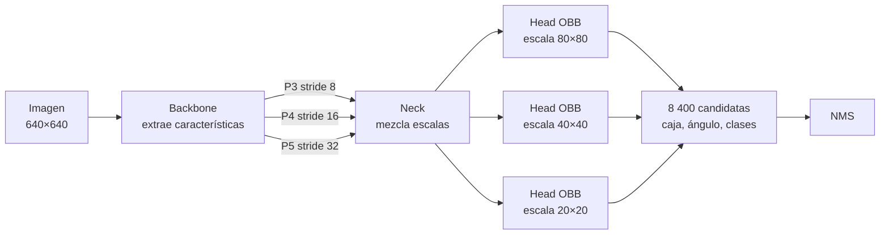
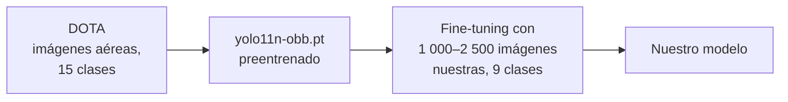

# 5. YOLO11 y transfer learning

**Objetivo:** saber qué hay *dentro* de YOLO11n-OBB (el paper no describe la arquitectura; el revisor 2 lo pidió), qué hace cada bloque, qué predice la cabeza OBB y qué significa hacer fine-tuning de un modelo preentrenado.

!!! info "Cómo se obtuvo esta descripción"
    La tabla de capas de abajo no está copiada de ningún documento: se extrajo cargando el checkpoint `models/ds2500_70ep_640px.pt` con Ultralytics 8.4.211 y listando sus módulos y parámetros.

## 5.1 Arquitectura: backbone, neck y head

Todo detector moderno de una etapa tiene tres partes:

- **Backbone**: la "columna vertebral"; convoluciones que convierten píxeles en características de distintos niveles de abstracción.
- **Neck** (cuello): combina características de varias escalas (**PAN/FPN**): las profundas (mucho contexto, poca resolución) se mezclan con las superficiales (mucho detalle espacial) para ayudar con objetos pequeños.
- **Head** (cabeza): convierte las características en predicciones finales.

### Las 24 capas de YOLO11n-OBB (nuestro modelo real)

| Capas | Módulo | Parámetros | Papel |
| --- | --- | ---: | --- |
| 0–1 | `Conv` | 464 + 4 672 | reducción inicial (stride 2 → 4) |
| 2, 4, 6, 8 | `C3k2` | 6 640 · 26 080 · 87 040 · 346 112 | bloque principal de extracción |
| 3, 5, 7 | `Conv` | 36 992 · 147 712 · 295 424 | reducción de resolución (stride 8, 16, 32) |
| 9 | `SPPF` | 164 608 | agrupa contexto a varias escalas |
| 10 | `C2PSA` | 249 728 | atención espacial (¿qué regiones importan?) |
| 11–22 | `Upsample`, `Concat`, `C3k2`, `Conv` | 793 696 en total | neck: sube y baja de escala combinando mapas |
| 23 | **`OBB`** | **504 094** | cabeza de detección orientada |
| **Total (modelo sin fusionar)** | | **2 663 262** | backbone 1 365 472 + neck 793 696 + head 504 094 |

!!! note "¿2 663 262 o 2 655 478?"
    Los conteos de la tabla son del modelo **tal como se entrena**, con las capas *BatchNorm* separadas. Para inferir, Ultralytics **fusiona** cada BatchNorm dentro de su convolución (matemáticamente equivalente, más rápido), lo que elimina 7 784 parámetros. El paper reporta **2 655 478**, la cifra del modelo fusionado (110 capas), que es la que se exporta a NCNN. Ambas son correctas; conviene decir cuál se reporta.

La cabeza consume los mapas de las capas **16** (stride 8), **19** (stride 16) y **22** (stride 32). Ocupa el 19 % de los parámetros; el 81 % restante es backbone y neck, y es lo que más se beneficia del preentrenamiento.

### Los bloques, en una línea

| Bloque | Qué es |
| --- | --- |
| `Conv` | convolución + **BatchNorm** (normaliza activaciones para entrenar estable) + **SiLU** |
| `C3k2` | variante eficiente de bloque residual: divide los canales, procesa una parte con pequeños bloques y concatena; "residual" = suma la entrada a la salida para que los gradientes fluyan |
| `SPPF` | *Spatial Pyramid Pooling – Fast*: tres max-pooling en cadena para ver contexto de distintos tamaños |
| `C2PSA` | bloque con **atención** (*Position-Sensitive Attention*): pondera qué posiciones del mapa son relevantes |

No hace falta memorizarlos: lo esencial es saber que el modelo es una cadena de convoluciones eficientes con algo de atención, y que **"n" = nano**, la variante más pequeña de la familia (n, s, m, l, x).

## 5.2 Transfer learning

**Entrenar desde cero** exigiría cientos de miles de imágenes: la red tiene que aprender qué es un borde, una textura, un vehículo visto desde arriba. **Transfer learning** parte de una red que ya aprendió esas cosas en otro problema y la **adapta** (*fine-tuning*).

Qué pasa exactamente al cargar `yolo11n-obb.pt` con `nc=9` (nuestras 9 clases en vez de las 15 de DOTA):

- Las capas con la **misma forma** se copian (backbone, neck y casi toda la cabeza).
- La capa final de clasificación (que produce un puntaje por clase) cambia de forma y se **reinicializa**.
- Ultralytics lo informa al iniciar: *"Transferred N/M items from pretrained weights"*.
- Después **todas** las capas se siguen entrenando (no congelamos nada: `freeze` no se usa en `args.yaml`).

!!! tip "Por qué funciona aquí"
    Dominio casi idéntico (vista cenital, vehículos pequeños, cajas rotadas) y pocas épocas: 55 iteraciones por época × 70 = 3 850 pasos. Desde cero, el baseline de `archive/baseline_from_scratch/` (una red propia pequeña) queda muy por debajo.

## 5.3 Qué predice la cabeza OBB

Para cada una de las 8 400 posiciones (a 640 px) la cabeza produce un vector de **74 números**:

| Parte | Tamaño | Significado |
| --- | --- | --- |
| Distribución de bordes | \(4\times16=64\) | para cada lado de la caja (izq., arriba, der., abajo), una distribución sobre 16 valores posibles de distancia (**DFL**); la distancia final es su valor esperado |
| Clases | 9 | un puntaje (sigmoide) por clase |
| Ángulo | 1 | un número que se convierte en radianes |
| **Total** | **74** | |

Detalles que ayudan a entender los resultados:

- **DFL** (*Distribution Focal Loss*): en lugar de predecir una distancia con un solo número, predice una distribución. Es más precisa para bordes ambiguos (autos parcialmente tapados por un árbol).
- **Ángulo**: la salida cruda pasa por una sigmoide y se mapea al rango \([-\pi/4,\,3\pi/4)\), un intervalo de 180° (\(\pi\) radianes) que cubre cada orientación distinta de un rectángulo una sola vez. Acotar el rango así evita que la red tenga que aprender que \(\theta\) y \(\theta+180^\circ\) son lo mismo (según el código de la cabeza OBB de Ultralytics; conviene verificarlo en la versión exacta que se cite).
- **Confianza de una detección** = puntaje de su clase más alta (YOLO11 ya no tiene un "objectness" separado).

## 5.4 La pérdida y la asignación

| Componente | Qué hace |
| --- | --- |
| **Box loss (ProbIoU)** | \(1-\text{ProbIoU}\) entre caja predicha y real (ver [cap. 4](04-cajas-orientadas.md)) |
| **Cls loss** | entropía cruzada binaria por clase |
| **DFL loss** | entrena la distribución de bordes |
| **Angle loss** | término adicional sobre el ángulo (columna `angle_loss` en nuestro `results.csv`) |
| **Asignación TAL** | cada objeto real se asigna a las candidatas con mejor *alineación* entre clase y ubicación |

## 5.5 Hiperparámetros reales de nuestros runs

Leídos de `args.yaml` del run de 70 épocas:

| Hiperparámetro | Valor | Comentario |
| --- | --- | --- |
| `epochs` / `patience` | 70 / 20 | early stopping nunca se activó |
| `batch` / `imgsz` | 32 / 640 | |
| `optimizer` | `auto` | Ultralytics decide. Con < ~10 000 iteraciones suele elegir **AdamW** con un *learning rate* calculado automáticamente (en ese caso `lr0=0.01` del archivo no se usa). Como el log del entrenamiento no se conservó, **no podemos confirmarlo**; el paper debe declarar el optimizador real |
| `lr0`, `lrf` | 0.01, 0.01 | tasa inicial y factor final |
| `warmup_epochs` | 3 | tasa creciente al inicio |
| `weight_decay` | 0.0005 | regularización |
| `mosaic` | 1.0 | aumento de datos: pega 4 imágenes en una |
| `close_mosaic` | 10 | desactiva mosaic las últimas 10 épocas |
| `scale`, `translate` | 0.5, 0.1 | zoom ±50 %, desplazamiento ±10 % |
| `fliplr` | 0.5 | espejo horizontal aleatorio |
| `degrees` | 0.0 | **sin** rotaciones aleatorias |
| `amp` | true | precisión mixta (más rápido en GPU) |
| `seed` | 2542 (= 42 + 2500) | |

!!! warning "Observaciones"
    - `degrees=0`: al entrenar un detector *orientado* **no se aumenta con rotaciones**. Es una decisión (o descuido) que merece estudiarse: rotar las imágenes generaría ejemplos con más variedad angular, justo lo que escasea (solo 7 % de cajas inclinadas).
    - `mosaic` y `scale` son aumentos fuertes que hacen los objetos aún más pequeños; con motos de ~4 px podrían perjudicar. Sin ablación no lo sabemos.

## 5.6 Familias y tamaños

Ultralytics ofrece cinco tamaños (`n`, `s`, `m`, `l`, `x`). Más grande = más precisión y más coste. **YOLO11n-OBB** es el más pequeño: 2.66 M de parámetros y ≈ 5.4 MB como `.pt` (FP16). Es el único probado en el paper: **no hay comparación con otro tamaño ni con otra arquitectura**, una crítica directa de ambos revisores.

## Resumen

- YOLO11n-OBB = backbone (capas 0–10) + neck (11–22) + cabeza OBB (23), 2 655 478 parámetros (fusionado; 2 663 262 sin fusionar).
- La cabeza predice, en 3 escalas, borde (DFL), clases y ángulo para 8 400 candidatas a 640 px.
- Transfer learning: reaprovechamos lo aprendido en DOTA y solo reinicializamos el clasificador de 9 clases.
- Hay decisiones de entrenamiento sin justificar ni estudiar (optimizador, sin rotación, mosaic).

!!! question "Comprueba que entendiste"
    1. ¿Cuántos números predice la cabeza OBB por posición con 9 clases y `reg_max=16`?
    2. ¿Qué parte de la red se reinicializa al hacer fine-tuning de DOTA (15 clases) a 9 clases?
    3. ¿Qué porcentaje de los parámetros está en la cabeza?
    4. ¿Por qué `degrees=0` puede ser una limitación en un detector orientado?

    ??? success "Respuestas"
        1. \(4\times16+9+1=74\).
        2. La capa final de clasificación (cambia de 15 a 9 salidas); el resto se copia.
        3. \(504\,094/2\,663\,262\approx 19\,\%\).
        4. Porque la augmentación por rotación podría aportar variedad angular que el dataset casi no tiene (solo ~7 % de cajas con > 10° de inclinación).

## Para profundizar

- Documentación de Ultralytics: *YOLO11* y *Oriented Bounding Boxes*.
- Khanam & Hussain, *YOLOv11: An Overview of the Key Architectural Enhancements*, arXiv 2024.
- Li et al., *Generalized Focal Loss*; Feng et al., *TOOD* (DFL y TAL).
