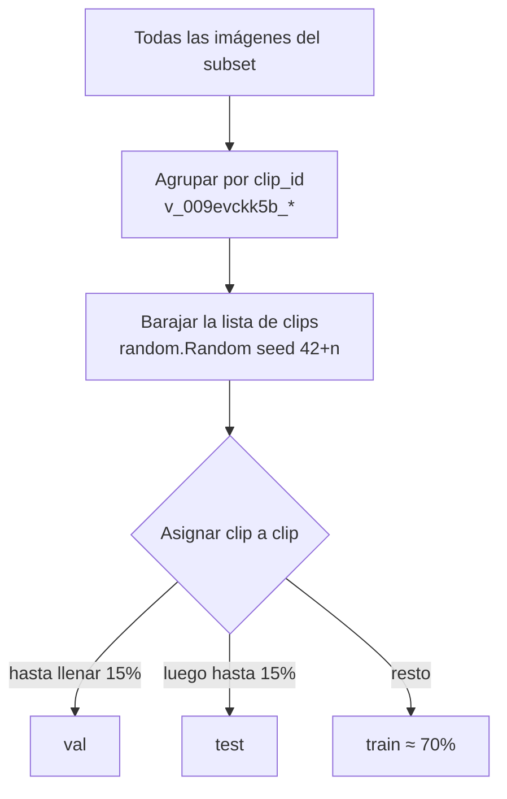

# 6. Datos, splits y fuga de información

**Objetivo:** entender de dónde vienen nuestros datos, cómo se construyeron los subconjuntos y los splits, qué es la **fuga de datos** y por qué —aun con un split correcto por clips— nuestro estudio de "escalado de datos" tiene un diseño débil.

## 6.1 El origen: MTC SMART Challenge

Los datos provienen de la competencia de Kaggle *MTC SMART Challenge: IA para la Movilidad del Perú* (Ministerio de Transportes y Comunicaciones). Son **frames extraídos de videos de dron** sobre calles de Lima, anotados con cajas orientadas. El conjunto completo de entrenamiento tiene 54 263 imágenes (según el script `scripts/partition_dataset.py`); nosotros trabajamos con subconjuntos de 1 000 a 3 000.

Formato de anotación (CSV con columnas `Id`, `Target`):

```text
Id,Target
v_009evckk5b_0000,1 533.545 1016.865 77.75 35.87 0;1 909.665 843.46 38.17 86.5 0;...;7 1680.19 132.055 118.4 49.67 0
```

Cada objeto es `clase cx cy w h ángulo` (píxeles y grados), separados por `;`. El `Id` es `<clip>_<frame>`: aquí `v_009evckk5b` es el **clip** (un video) y `0000` el índice del frame dentro de él.

### Las 9 clases

| id CSV | Clase | Descripción (aprox.) |
| ---: | --- | --- |
| 1 | `car` | automóvil |
| 2 | `van` | combi / van (en el intento previo del repo, `archive/yolo_training_windows/dataset.yaml`, se llamaba "Combi") |
| 3 | `microbus` | microbús |
| 4 | `minibus` | minibús |
| 5 | `bus` | ómnibus |
| 6 | `articulated_bus` | bus articulado |
| 7 | `truck` | camión |
| 8 | `mototaxi` | mototaxi (vehículo de tres ruedas) |
| 9 | `motorcycle` | motocicleta |

En los archivos YOLO los ids van de 0 a 8 (se resta 1 al convertir).

## 6.2 Qué sabemos del dataset (cifras calculadas)

Subconjunto de 2 500 imágenes:

| Propiedad | Valor |
| --- | --- |
| Resolución de las imágenes | 1920 × 1080 |
| Clips distintos | **1 088** |
| Frames por clip | 2–3 (índices típicos: 0, 24, 49) |
| Cajas totales | 27 841 (11.1 por imagen) |
| Imágenes sin ningún vehículo | 163 (6.5 %) |
| Lado corto mediano de una caja | 35 px (p10 = 27, p90 = 41) |
| Auto: lado corto / largo medianos | 35 / 87 px |
| Moto: lado corto / largo medianos | 12.8 / 40.8 px |

!!! example "Qué significa el tamaño en la práctica"
    Con la escala de entrada de 544 px (factor 0.283), el lado corto mediano de un vehículo es **≈ 10 px** y el de una moto **≈ 3.6 px**. Un detector con stride mínimo 8 produce una celda cada 8 px: las motos son menores que una celda. Lee de nuevo el [capítulo 1](01-fundamentos.md#redimensionado-resize-letterbox).

### Desbalance de clases (Tabla 2 del paper)

| Clase | Instancias totales | % |
| --- | ---: | ---: |
| `car` | 22 322 | 80.2 % |
| `motorcycle` | 2 178 | 7.8 % |
| `truck` | 1 499 | 5.4 % |
| `minibus` | 873 | 3.1 % |
| `van` | 469 | 1.7 % |
| `mototaxi` | 250 | 0.9 % |
| `microbus` | 128 | 0.5 % |
| `bus` | 112 | 0.4 % |
| `articulated_bus` | **10** | 0.04 % |

Consecuencias: (1) el modelo ve muchísimos más autos que buses; (2) `articulated_bus` tiene **8 instancias en train y 2 en test**, ninguna en validación: no se puede ni entrenar ni evaluar de forma fiable; (3) el mAP promedia clases por igual (ver [capítulo 3](03-metricas.md)), así que clases casi vacías pesan mucho en la cifra final. No usamos ninguna técnica de balanceo (pesos por clase, sobremuestreo).

## 6.3 La fuga de información (*data leakage*)

**Fuga** es cuando información del conjunto de evaluación se "cuela" en el entrenamiento, haciendo que el modelo parezca mejor de lo que realmente es. La forma más traicionera: **muestras casi idénticas repartidas entre train y test**.

!!! example "El caso de nuestros frames"
    Dos frames del mismo clip (índices 0 y 24) muestran la misma esquina de Lima: los mismos edificios, los mismos árboles, los mismos **autos estacionados** (que no se mueven). Si el frame 0 está en train y el 24 en test, el modelo puede "reconocer" la escena y los autos parqueados sin haber generalizado nada. Si dividieras al azar por **imagen**, esto ocurriría constantemente.

La solución del proyecto es el **split por clips** (`clip_level_indices` en `src/swole_yolo/data.py`):



Detalles del algoritmo:

- Los clips son **indivisibles**, por eso los tamaños no son exactamente 70/15/15 (para 2 500 imágenes: 1 748 / 376 / 376 en vez de 1 750 / 375 / 375).
- La semilla es `42 + n` (tamaño del subconjunto): reproducible, pero **distinta para cada tamaño**, lo que tiene una consecuencia metodológica importante (siguiente sección).

!!! warning "Límite de esta protección"
    Un split por clips evita la fuga *entre frames de un mismo video*, pero no entre **videos distintos de la misma ubicación** (el mismo cruce filmado en dos momentos del día). Si el dataset trae metadatos de ubicación, un split por *escena* sería más estricto. No sabemos cuántas ubicaciones distintas hay en los 1 088 clips: es un dato que conviene averiguar y reportar.

## 6.4 Cómo se formaron los subconjuntos (y un problema de diseño)

Medimos la relación entre los subconjuntos:

| Hecho | Resultado |
| --- | --- |
| ¿Están anidados? | **Sí**: 1 000 ⊂ 1 500 ⊂ 2 000 ⊂ 2 500 ⊂ 3 000 (las 1 000 imágenes del menor están todas en el mayor, etc.) |
| Clips distintos en `dataset_1000` | 1 000 (**un frame por clip**) |
| Clips distintos en `dataset_1500` … `dataset_3000` | **1 088, siempre los mismos** |
| Clips del test de 2 500 que aparecen en *train* del experimento de 3 000 | 117 de 166 (70 %) |

Esto cambia por completo la lectura del "estudio de escalado de datos":

!!! failure "El experimento de escalado no escala lo que dice escalar"
    - De 1 500 a 3 000 imágenes **no se añaden escenas nuevas**: se añaden más *frames de las mismas 1 088 escenas*. Subir de 1 000 a 1 500 es, sobre todo, pasar de 1 frame por clip a ≈ 1.4. El paper habla de "cantidad de datos de dominio" pero la diversidad (clips) casi no cambia.
    - Cada tamaño tiene **su propio conjunto de test** (150, 225, 300, 376, 452 imágenes) porque la semilla cambia. Las diferencias entre filas de la Tabla 3 mezclan "más entrenamiento" con "un examen distinto". Es el defecto que señalan ambos revisores.
    - Un examen distinto importa: vimos que el *mismo* modelo obtiene 0.860 en validación y 0.914 en test dentro del subconjunto de 2 500 (ambos de 376 imágenes). Esa variación de 5 puntos es del orden de los efectos que se quieren medir.

### Cómo debería hacerse

1. **Un único test fijo**, reservado desde el inicio, con clips que *nunca* entran en ningún entrenamiento.
2. Subconjuntos de train **anidados** y comparables (1 000, 1 500, …) extraídos de los clips restantes.
3. Variar **dos ejes por separado**: número de *clips* (diversidad) y número de *frames por clip* (redundancia).
4. **Varias semillas** por tamaño y reportar media ± intervalo.

## 6.5 Otros problemas de datos a tener presentes

| Problema | Descripción | Estado |
| --- | --- | --- |
| **Ruido de etiquetas** | cajas imprecisas o ausentes (un auto sin anotar cuenta como FP "injusto") | no auditado |
| **Cajas en el borde** | recorte esquina por esquina a \([0,1]\) (cap. 4) | no cuantificado |
| **Imágenes extra** | `dataset_2500/images` tiene 2 515 jpg para 2 500 filas | el CSV manda; origen por aclarar |
| **Cobertura** | no sabemos la distribución de hora del día, clima ni ubicaciones | el paper lo admite como limitación |
| **Licencia/uso** | datos de una competencia Kaggle con sus términos | revisar antes de publicar modelos o datos derivados |

## Resumen

- Dataset: frames de dron 1920×1080, 9 clases, muy desbalanceado, vehículos pequeños.
- Split por clips evita la fuga entre frames de un video, pero no resuelve que cada tamaño use un test distinto.
- Los subconjuntos están anidados y de 1 500 en adelante comparten los mismos 1 088 clips: el "escalado" es en redundancia más que en diversidad.

!!! question "Comprueba que entendiste"
    1. ¿Por qué un split aleatorio por imagen inflaría el mAP?
    2. ¿Por qué los splits por clips no dan exactamente 70/15/15?
    3. En `dataset_1000`, ¿cuántas imágenes tiene cada clip? ¿Y en `dataset_2500`?
    4. Diseña un experimento que separe el efecto de "más clips" del de "más frames por clip".

    ??? success "Respuestas"
        1. Frames casi idénticos (misma escena, mismos autos estacionados) quedarían en train y test; el modelo puntúa por memoria de la escena.
        2. Los clips son indivisibles y se asignan completos hasta alcanzar o superar el objetivo.
        3. 1 y 2–3 respectivamente.
        4. Fijar un test y mantener constante el total de imágenes de train (p. ej. 500). Comparar (a) 500 clips × 1 frame, (b) 250 clips × 2 frames, (c) 167 clips × 3 frames, con varias semillas. Si (a) supera a (c), la diversidad de escenas importa más que la cantidad de frames.

## Para profundizar

- Kapoor & Narayanan, *Leakage and the Reproducibility Crisis in ML-based Science*, Patterns 2023.
- Roberts et al., *Cross-validation strategies for data with temporal, spatial, hierarchical, or phylogenetic structure*, Ecography 2017 (por qué hay que agrupar muestras correlacionadas).
