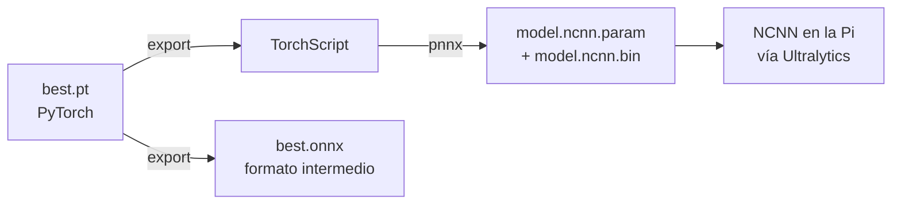

# 7. Inferencia en el borde (edge)

**Objetivo:** entender qué es NCNN y por qué lo usamos, cómo se convierte un modelo entrenado para una Raspberry Pi, y cómo medir de forma defendible latencia, throughput y comportamiento térmico. Es la respuesta a varias preguntas del revisor 2.

## 7.1 Qué es "edge" y por qué importa

**Edge computing / Edge AI**: ejecutar el modelo **en el dispositivo** (la cámara, un mini-PC) en lugar de enviar el video a un servidor. Ventajas: menor latencia, menos ancho de banda, privacidad, funciona sin conexión, y un costo por cámara bajo. Costo: hardware limitado.

| | Servidor con GPU | Raspberry Pi 4 Model B (8 GB) |
| --- | --- | --- |
| Cómputo | miles de núcleos paralelos | 4 núcleos ARM Cortex-A72 (CPU) |
| Memoria | decenas de GB (VRAM) | 8 GB compartidos |
| Potencia | 100–400 W | ≈ 3–7 W |
| Precio | miles de USD | ≈ 75–100 USD |
| Refrigeración | activa | pasiva o ventilador pequeño |

## 7.2 De PyTorch a NCNN

El modelo se entrena en **PyTorch** (formato `.pt`), un entorno pesado pensado para investigación. En el dispositivo conviene un **motor de inferencia** ligero y optimizado para su CPU.

### ¿Qué es NCNN?

**NCNN** es un framework de inferencia de redes neuronales de código abierto, escrito en C++ por Tencent, pensado para **móviles y sistemas embebidos**. Sus rasgos:

- **Sin dependencias de terceros** y con un binario pequeño.
- Optimizaciones para **ARM** (instrucciones **NEON**) y soporte multihilo.
- Soporte opcional de GPU vía Vulkan.
- Formato de modelo en dos archivos: **`.param`** (texto: el grafo de la red) y **`.bin`** (los pesos).

### ¿Por qué lo elegimos?

La decisión no está justificada en el paper (el revisor lo notó). Las razones que se pueden sostener son prácticas: Ultralytics lo exporta con una sola instrucción (`format="ncnn"`), está optimizado para ARM y es muy usado en Raspberry Pi. **No comparamos con alternativas**: ONNX Runtime, TensorFlow Lite o PyTorch directo podrían ser más rápidos o más lentos. Esa comparación es una mejora obligatoria para una revista (ver [plan](../PLAN.md)).

### Cómo lo hicimos

1. En `finetune.py`: `best_model.export(format="ncnn", imgsz=...)`. Ultralytics usa **pnnx** para convertir (hay un `model_pnnx.cpython-312.pyc` en cada carpeta exportada) y genera `model.ncnn.param`, `model.ncnn.bin`, `metadata.yaml` y un `model_ncnn.py` de ejemplo.
2. Copiar la carpeta `*_ncnn_model` a la Pi.
3. En la Pi: `YOLO("<carpeta>", task="obb").predict(...)`, que internamente llama al paquete `ncnn`.
4. Medir con `scripts/bench_pi.py` (ver [Reproducir](../proyecto/reproduccion.md)).

Tamaños que ya conocemos: 2 655 478 parámetros × 4 bytes (FP32) ≈ 10.1 MiB → el NCNN pesa **10.23 MB** (el `.pt` pesa ~5.4 MB porque guarda en FP16). Los tres modelos pesan lo mismo porque tienen la misma arquitectura; lo que cambia es el tamaño de entrada.

### Cuantización (lo que no hicimos)

| Precisión | Bytes/parámetro | Tamaño aprox. | Efecto típico |
| --- | --- | --- | --- |
| FP32 | 4 | 10.2 MB | referencia (lo que medimos) |
| FP16 | 2 | 5.1 MB | casi igual precisión; en ARM A72 la ganancia de velocidad depende del soporte de hardware |
| INT8 | 1 | 2.6 MB | normalmente más rápido y pequeño; puede perder algo de precisión y requiere un conjunto de **calibración** |

INT8 es la palanca más prometedora para acercarse al tiempo real en una Pi 4.

## 7.3 Cómo medir velocidad correctamente

### Latencia vs. throughput vs. FPS

- **Latencia**: tiempo desde que entra *una* imagen hasta que salen sus detecciones (ms).
- **Throughput**: imágenes procesadas por segundo en régimen continuo.
- Con **batch 1** y procesamiento secuencial: \(\text{FPS}=1000/\text{latencia}_{ms}\). Es nuestro caso: 300.5 ms → 3.33 FPS. Con *batch* mayor o varios procesos en paralelo el throughput podría subir sin bajar la latencia por imagen.

### Reglas para una medición defendible

1. **Calentamiento** (*warm-up*): las primeras ejecuciones son más lentas (carga de memoria, cachés). Se descartan (usamos 5).
2. **Muchas repeticiones** (300 imágenes) y reportar **media, desviación, mediana, P95** y máximo, no solo la media.
3. **P95**: la latencia que el 95 % de las imágenes no supera. Importa en tiempo real: la media puede ser buena y aun así haber picos.
4. **Controlar el entorno**: temperatura inicial, **governor** de CPU, número de hilos, procesos en segundo plano, alimentación.
5. **Declarar qué se mide**: ¿solo la red o *end-to-end* (lectura, preproceso, red, NMS)?

### Qué contiene nuestro número

Desglose medido en la Pi (promedios de 300 imágenes):

| Modelo | Preproceso | **Red (inferencia)** | NMS (postproceso) | Resto* | **Total** |
| --- | ---: | ---: | ---: | ---: | ---: |
| 1 000 img · 544 px | 9.3 ms | 253.6 ms | 4.3 ms | 35.2 ms | **302.4 ms** |
| 2 500 img · 544 px | 9.3 ms | 254.9 ms | 4.2 ms | 32.1 ms | **300.5 ms** |
| 2 500 img · 640 px | 9.5 ms | 353.4 ms | 4.9 ms | 32.1 ms | **399.9 ms** |

\* "Resto" = total medido − (pre + red + post) reportados por Ultralytics. Es, con casi seguridad, la **lectura y decodificación del JPEG de 1920×1080** desde disco, que `predict()` hace pero no cuenta en su desglose. En un pipeline real de video ese costo es distinto (decodificación H.264, etc.).

!!! success "Una verificación de cordura que sí cuadra"
    El tiempo de red pasa de 254.9 ms (544 px) a 353.4 ms (640 px): ×1.386. El número de píxeles crece \((640/544)^2=\)**×1.384**. Es decir, la latencia de la red es casi exactamente **proporcional al número de píxeles**, como predicen los FLOPs. La latencia total sube menos (×1.33) porque ~32 ms (el "resto") no depende de la resolución.

### Preguntas del revisor, respondidas

- **"¿Por qué varía el FPS en la Tabla 3?"** Esa tabla es de la **CPU de escritorio**, no de la Pi: 30.4–32.3 FPS para modelos de arquitectura *idéntica* y misma resolución. Las diferencias (≈ 6 %) son **ruido de medición** (30 imágenes, 1 imagen de calentamiento, sin controlar el estado de la CPU). No hay ninguna razón arquitectónica para que difieran. La tabla no aporta información y, además, genera dudas: conviene eliminarla del paper o medirla bien.
- **"¿Cuántos hilos?"** El JSON original muestra los 4 núcleos al 77–95 % de uso, es decir, NCNN usó 4 hilos (el valor por defecto con 4 núcleos disponibles). Aun así el paper no lo declara explícitamente: debe hacerlo.

## 7.4 Comportamiento térmico y *throttling*

Una CPU que se calienta **reduce su frecuencia** para protegerse (*thermal throttling*), y la latencia sube. En la Pi:

- Temperatura en el SoC (`/sys/class/thermal/thermal_zone0/temp`).
- `vcgencmd get_throttled` devuelve una máscara de bits: bit 0 (bajo voltaje ahora), 1 (frecuencia limitada ahora), 2 (throttling ahora), 3 (límite térmico suave ahora) y los bits 16–19 indican que cada uno **ha ocurrido desde el arranque**.
- Un **governor** de CPU (`performance`, `ondemand`, `schedutil`…) decide la frecuencia. Con `ondemand` la frecuencia puede variar durante el test y alterar los resultados.

En nuestras mediciones: la temperatura subió **17–20.5 °C en 90–120 s**, hasta 65–70 °C, y el flag final fue `0x0`. La Pi 4 empieza a limitar alrededor de los 80 °C, por lo que **no se alcanzó** ese punto, pero la temperatura seguía subiendo: 90 s no demuestran un régimen estable. Para afirmar que no hay throttling bajo operación continua se necesita una prueba de **varios minutos a horas** con registro continuo (el nuevo `bench_pi.py` toma muestras cada 10 imágenes).

## 7.5 ¿Qué significa "tiempo real"?

Depende del video de origen. El dataset es de **10 FPS**; para procesarlo sin perder fotogramas hace falta ≤ 100 ms por imagen. Estamos en 300 ms (3.3 FPS): **3 veces más lento**. Opciones realistas para cerrar la brecha:

| Palanca | Idea | Costo esperado |
| --- | --- | --- |
| Menor resolución | latencia ∝ píxeles | pierde las motos (ya difíciles) |
| INT8 / FP16 | menos cómputo por operación | calibración; posible caída de precisión |
| Modelo aún menor / otro diseño | menos FLOPs | menos precisión |
| Saltar frames + *tracking* | detectar cada \(k\) frames y seguir con un tracker barato | complejidad |
| Aceleradores (Coral, Hailo, Jetson) | hardware dedicado | costo del equipo |

Para **conteo de vehículos** no hace falta procesar todos los frames; basta con que ningún vehículo cruce la zona sin ser visto, lo que permite menos de 10 FPS combinando detecciones con seguimiento.

## Resumen

- NCNN es un motor de inferencia ligero para ARM; el modelo pasa de `.pt` a `.param`+`.bin`.
- Una medición válida declara hardware, versión, hilos, governor, calentamiento, y reporta media, P95 y desviación.
- Nuestros 300 ms = 255 ms de red + ≈ 14 ms de pre/post + ≈ 32 ms de lectura de JPEG; la red escala con los píxeles.
- 90 s de prueba no establecen el comportamiento térmico.

!!! question "Comprueba que entendiste"
    1. Si la latencia media es 400 ms, ¿cuántos FPS tienes con batch 1?
    2. ¿Por qué descartar las primeras ejecuciones?
    3. Si pasas de 544 a 512 px, ¿qué cambio de latencia de red esperas (aprox.)?
    4. ¿Qué indica que el flag de throttling sea `0x0` al final y la temperatura aún suba?

    ??? success "Respuestas"
        1. \(1000/400 = 2.5\) FPS.
        2. Son más lentas por cargas iniciales y cachés vacíos; contaminan el promedio.
        3. Los píxeles bajan \((512/544)^2=0.886\): ≈ −11 % en el tiempo de red.
        4. Que aún no hubo limitación, pero el sistema no llegó al equilibrio térmico: puede ocurrir en una prueba más larga.

## Para profundizar

- Repositorio de NCNN (Tencent) y su wiki de conversión.
- Jacob et al., *Quantization and Training of Neural Networks for Efficient Integer-Arithmetic-Only Inference*, CVPR 2018.
- Santos et al., *Real-time object detection performance analysis using YOLOv7 on edge devices*, IEEE Latin America Transactions 2024 (ref. [6] del paper).
