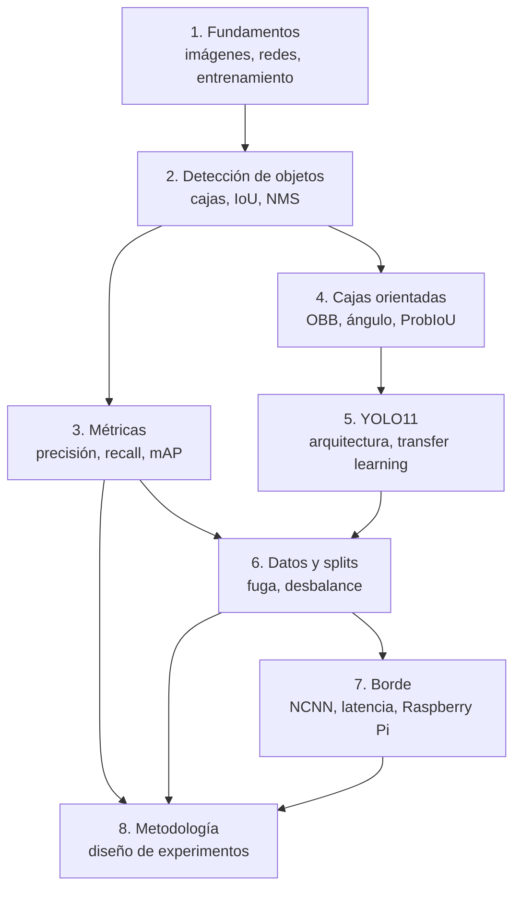

# Cómo usar esta guía

Esta guía asume que **no sabes nada** de visión por computadora ni de aprendizaje automático. Cada capítulo construye sobre el anterior, define cada término la primera vez que aparece y termina mostrando **dónde vive ese concepto en nuestro código y en nuestros números**.

## Ruta recomendada

| Si tu objetivo es… | Lee |
| --- | --- |
| Entender el proyecto de punta a punta | Todo, en orden (≈ 6–8 horas) |
| Entender las críticas de los revisores | 3, 6, 8 |
| Poder modificar el código de entrenamiento | 1, 2, 4, 5 y luego [Arquitectura del código](../proyecto/arquitectura.md) |
| Repetir las mediciones en la Raspberry Pi | 7 y [Reproducir los resultados](../proyecto/reproduccion.md) |

## Convenciones

!!! example "Ejemplo numérico"
    Los recuadros como este muestran cálculos hechos a mano que puedes repetir con una calculadora.

!!! tip "En nuestro proyecto"
    Estos recuadros conectan el concepto con un archivo, una cifra o una decisión concreta de `swole-yolo`.

!!! question "Comprueba que entendiste"
    Al final de cada capítulo hay preguntas. Si no puedes responderlas sin mirar, vuelve a leer esa sección. Las respuestas están en un bloque desplegable.

!!! warning "Trampa común"
    Errores de interpretación frecuentes, incluidos algunos que el propio paper comete o está cerca de cometer.

- Las fórmulas están en notación estándar; todas se explican en palabras.
- Los datos citados (cantidad de cajas, tamaños en píxeles, etc.) se calcularon sobre el dataset real del repositorio; no son estimaciones.
- Los términos en **negrita** están en el [glosario](glosario.md).

## Referencias generales (para ir más allá)

- Goodfellow, Bengio, Courville. *Deep Learning*. MIT Press, 2016. Fundamentos de redes neuronales.
- Stanford CS231n, *Convolutional Neural Networks for Visual Recognition*. Notas de curso abiertas; el mejor punto de partida para convoluciones y detección.
- Zhang, Lipton, Li, Smola. *Dive into Deep Learning* (d2l.ai). Libro interactivo con código.
- Documentación de Ultralytics (`docs.ultralytics.com`): referencia del software que usamos.
