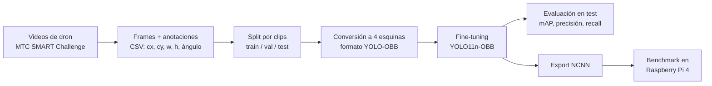

# swole-yolo

Detección de vehículos con **cajas orientadas** (OBB) usando **YOLO11n-OBB** sobre imágenes de tráfico peruano, y medición de su velocidad en una **Raspberry Pi 4**.

Este sitio tiene dos partes:

- :material-school: **[Guía de aprendizaje](guia/index.md)**

    De cero a experto. Explica, sin saltarse pasos, cada concepto que aparece en el proyecto: desde qué es una imagen para una computadora hasta cómo se mide la latencia en un dispositivo ARM. Cada capítulo termina señalando **dónde aparece ese concepto en nuestro código**.

- :material-source-branch: **[El proyecto](proyecto/arquitectura.md)**

    Cómo está organizado el código, cómo reproducir las cifras del paper, qué dicen realmente los resultados (incluidos sus límites) y el [plan de revisión](PLAN.md) tras el rechazo en SIMBig 2026.

## El proyecto en un minuto

| Pregunta | Respuesta corta | Dónde profundizar |
| --- | --- | --- |
| ¿Qué detectamos? | 9 clases de vehículos (auto, moto, mototaxi, bus…) | [Datos](guia/06-datos.md) |
| ¿Por qué cajas orientadas? | Ajustan mejor a un vehículo girado que una caja horizontal | [OBB](guia/04-cajas-orientadas.md) |
| ¿Con qué modelo? | YOLO11n-OBB, 2.66 M de parámetros, preentrenado en DOTA | [YOLO11](guia/05-yolo11.md) |
| ¿Qué tan bueno es? | 93.9 % mAP@50 en test (640 px, 2 500 imágenes) | [Métricas](guia/03-metricas.md), [Resultados](proyecto/resultados.md) |
| ¿Qué tan rápido es? | 2.5–3.3 FPS en Raspberry Pi 4 | [Edge](guia/07-edge.md) |

!!! warning "Estado del paper"
    El paper fue rechazado en SIMBig 2026. Las reseñas y un análisis propio de sus debilidades están en el [plan de revisión](PLAN.md). Esta guía existe, en parte, para que todo el equipo pueda entender esas críticas y resolverlas.
