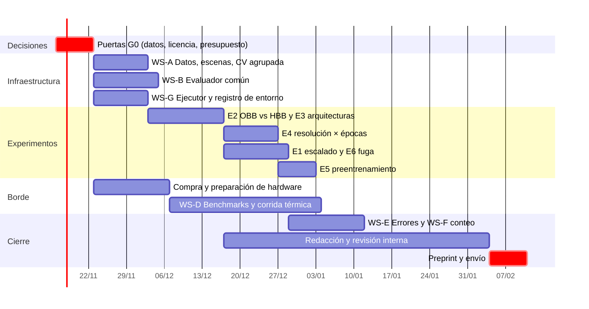

# Plan de mejora hacia una revista Q3 o mejor

Este documento es la hoja de ruta. El detalle científico (hipótesis, protocolos, estadística) está en el [protocolo experimental](protocolo_experimental.md); léelo antes de correr experimentos.

!!! info "Cómo se construyó"
    Se basa en (1) las dos reseñas de SIMBig, (2) la [auditoría del paper](../guia/08-metodologia.md#87-auditoria-de-las-afirmaciones-del-paper), (3) hechos medidos sobre los datos y checkpoints reales y (4) la [revisión de literatura](../literatura/revision.md) verificada. Los costos y plazos son **estimaciones**: se marcan como tales.

## 1. Tesis del trabajo: de "afinamos YOLO" a una pregunta científica

El paper rechazado dice "afinamos un modelo comercial y funciona". Eso es incremental (revisor 1) y sin comparación (ambos revisores). La literatura confirma que no hay novedad algorítmica que defender ni "primer dataset aéreo latinoamericano" (UTUAV y YucaMex-Drone son anteriores). Lo que **sí** está abierto, y es defendible con evidencia:

> **¿Cuándo y cuánto ayudan las cajas orientadas en la detección vehicular cenital con pocos datos, y qué cuesta desplegarlas en una CPU ARM de bajo costo?**

Es una tesis de **evidencia controlada**, no de arquitectura. Su valor está en responder bien preguntas que hoy se asumen. Cualquier resultado (OBB ayuda / no ayuda) es publicable si el diseño es sólido.

### Contribuciones objetivo

| ID | Contribución | Evidencia necesaria | Por qué es defendible | Riesgo |
| --- | --- | --- | --- | --- |
| **C1** | Comparación controlada **OBB vs. HBB** con evaluador común, global y por inclinación | experimento E2 + evaluador común (WS-B) | No se encontró estudio controlado cuando ~81 % de las cajas están casi alineadas a los ejes | OBB podría no ganar: aun así es un hallazgo |
| **C2** | Comparación de arquitecturas/tamaños **bajo un evaluador único** | E3 | Ultralytics valida con ProbIoU: las cifras no son comparables con DOTA sin esto | cómputo de MMRotate (opcional) |
| **C3** | **Curva de aprendizaje con diseño correcto**, medida en clips y escenas, con intervalos | E1, E5 | Corrige el defecto central criticado; cuantifica además la inflación por fuga | los datos podrían ser solo 1 088 clips |
| **C4** | **Caracterización del borde para OBB en CPU ARM** con protocolo térmico y de precisión | E7 | No se encontraron mediciones de OBB en Raspberry Pi; faltan benchmarks con P95, hilos, governor y temperatura juntos | disponibilidad de hardware |
| **C5** | **Taxonomía peruana** de 9 clases en vista cenital: estadísticas, convención de anotación, análisis de errores por clase | WS-A, WS-E | Ninguna fuente revisada combina cenital + OBB + mototaxi/microbús/minibús/articulado | licencia del dataset del MTC |
| C6 *(opcional)* | Error de **conteo por clase** | métrica de conteo por frame | Responde la observación del revisor 1 sobre "cuantificación" | requiere anotación frame a frame |

## 2. De los comentarios de los revisores a acciones

| # | Comentario | Estado | Dónde se resuelve |
| --- | --- | --- | --- |
| R1 | Contribución incremental, sin aporte algorítmico | Reformulada | Tesis y C1–C5 |
| R1 | Sin baseline de ningún tipo | **Pendiente** | E2, E3, E4 |
| R1 | Escalado confundido (test propio por subconjunto) | **Pendiente** (declarado en el paper) | E1 + protocolo de CV por escenas |
| R1 | "El título promete cuantificación" | Parcial (título moderado) | C6 / métrica de conteo |
| R2 | Keywords en el abstract | **Hecho** (Etapa 3) | — |
| R2 | Introducción: problema, motivación, organización | **Hecho** (Etapa 3) | — |
| R2 | Related Work débil (3–5 años) | **Hecho** (Etapa 4; 15 fuentes nuevas en el paper) | `docs/literatura/` |
| R2 | Qué es NCNN, por qué, cómo se convirtió | **Hecho** (Etapa 3) | — |
| R2 | ¿Dónde está el código y cómo se hicieron las pruebas? | **Hecho** (repo + scripts); falta hacerlo público | WS-G |
| R2 | Sin comparación con otras arquitecturas ni hardware | **Pendiente** | E3, E7 |
| R2 | Arquitectura no presentada | **Hecho** (Etapa 3) | — |
| R2 | ¿Por qué varía el FPS en la Tabla 3? | **Hecho** (ruido; tabla eliminada) | — |
| R2 | "640 px no prueba que 640 sea mejor" | **Pendiente** | E4 (factorial resolución × épocas) |
| R2 | Experimento de escalado con fallas | **Pendiente** | E1 |
| R2 | Conclusión débil | Mejorada; se reescribe al tener resultados | Redacción |

## 3. Puertas de decisión previas (bloquean todo lo demás)

Antes de gastar cómputo, el equipo debe resolver estas seis cuestiones. Cada una cambia el diseño.

| # | Pregunta | Por qué importa | Si la respuesta es "no" |
| --- | --- | --- | --- |
| **G0.1** | ¿Tenemos el dataset **completo** (`train.csv` de 54 263 imágenes)? | **Indicio fuerte:** 54 263 ÷ 1 088 clips = 49.9 frames por clip, es decir, **los 1 088 clips podrían ser todo el dataset**, con ~50 frames anotados cada uno. Hay que confirmarlo con el CSV original | **Plan B:** trabajar solo con los 3 000 frames de `data/` (limita el escalado en frames por clip; el test fijo es más pequeño) |
| **G0.2** | ¿Qué permite la **licencia / términos** del MTC SMART Challenge? (publicar etiquetas, splits, pesos, imágenes de ejemplo) | No hay referencia citable del dataset; sin permiso no se puede describirlo ni liberar derivados | Liberar solo código, identificadores de splits y pesos; pedir autorización a los organizadores |
| **G0.3** | ¿El repositorio será **público** y con DOI (Zenodo)? | El paper ya cita la URL; es parte de la respuesta al revisor 2 | Citar solo "disponible bajo solicitud" (más débil) |
| **G0.4** | ¿Presupuesto de **cómputo y hardware** y de APC? | Decide el alcance (MVP vs. completo) y la revista | Alcance MVP + revista sin APC (p. ej. IEEE Latin America Transactions) |
| **G0.5** | ¿Qué **cuartil exige** la institución, y en qué base (Scopus/SJR o JCR/WoS)? | El cuartil de todas las revistas candidatas **sigue sin confirmar** (SCImago bloqueó el acceso automático) | Abrir scimagojr.com a mano y fijar la lista corta |
| **G0.6** | ¿Quién hace qué? (datos/evaluador, entrenamientos, borde, redacción) | Cuatro autores; cada flujo necesita un responsable | — |

## 4. Flujos de trabajo (workstreams)

Prioridad: **[M]** imprescindible, **[S]** recomendado, **[C]** opcional. Esfuerzo en días-persona (estimación).

### WS-A · Datos y protocolo de partición [M] · ≈ 4 d

| Tarea | Entregable |
| --- | --- |
| Auditar el dataset crudo (G0.1): clips, frames por clip, anotación en todos los frames, distribución por clase | `docs` + tabla de estadísticas |
| **Agrupar clips en escenas** (embeddings de la primera imagen + clustering) para detectar ubicaciones repetidas | lista `clip → escena` |
| Generar **CV agrupada de 5 pliegues por escena**, estratificada por clase (`StratifiedGroupKFold`) | `data/splits/fold{0..4}.json` versionado |
| Auditar la **convención de anotación** (¿se omiten vehículos estacionados?) revisando ≥ 200 imágenes al azar | tasa de error/omisión estimada |
| Ficha de datos (data card): origen, licencia, altura, cobertura horaria/clima | `docs/datos.md` |

### WS-B · Evaluador común [M] · ≈ 5 d

Implementar (y probar con casos conocidos) un evaluador que calcule el mismo AP con **tres** criterios de IoU: **polígono exacto** (estilo DOTA), **ProbIoU** (el de Ultralytics) y **caja horizontal envolvente**. Con intervalos por *bootstrap* por clip. Es lo que hace comparables HBB y OBB, y lo que permite hablar con DOTA/MMRotate. Reportar la diferencia entre evaluadores es en sí una contribución metodológica pequeña.

### WS-C · Experimentos de modelo [M] · ver [protocolo](protocolo_experimental.md)

| ID | Experimento | Pregunta | Prioridad |
| --- | --- | --- | --- |
| E1 | Curva de aprendizaje: test fijo por escenas, subconjuntos anidados, 5 pliegues, **diversidad (clips) vs. redundancia (frames)** | ¿Cuántos datos hacen falta y de qué tipo? | M |
| E2 | **OBB vs. HBB** (mismo modelo, datos, pliegues, presupuesto) | ¿Ayuda OBB? ¿en qué subconjunto? | M |
| E3 | **Arquitecturas/tamaños**: YOLO11n/s-OBB, YOLOv8n-OBB, YOLO26n-OBB (+ YOLO12n-OBB sin preentrenamiento DOTA; RTMDet-R-tiny como comparador externo) | ¿Qué cambia con otra arquitectura? | M (núcleo) / C (RTMDet-R) |
| E4 | **Resolución × épocas** (factorial) y entrenamiento hasta convergencia | ¿La resolución ayuda a vehículos pequeños? | M |
| E5 | **Preentrenamiento**: DOTA-OBB vs. COCO vs. desde cero | ¿Cuánto aporta DOTA? | S |
| E6 | **Fuga cuantificada**: partición por frame vs. por clip vs. por escena | ¿Cuánto infla el mAP una partición mala? | S |

!!! note "Modelos disponibles (verificado)"
    Con Ultralytics 8.4.211 se descargaron pesos preentrenados OBB de `yolov8n-obb` (3.09 M parámetros), `yolo11s-obb` (9.72 M) y `yolo26n-obb` (**2.65 M**, mismo tamaño que YOLO11n: comparación limpia). **No existe** `yolo12n-obb.pt`: solo la configuración `yolo12-obb.yaml`, así que solo se puede entrenar sin preentrenamiento DOTA y no es comparable en igualdad de condiciones. Para HBB se usa `yolo11n.pt` (COCO).

### WS-D · Borde [M/S] · ≈ 8 d + hardware

| Tarea | Prioridad |
| --- | --- |
| Verificar cómo **fijar los hilos** de NCNN a través de Ultralytics (incertidumbre abierta desde el benchmark original) | M |
| Repetir el benchmark original con `bench_pi.py` (cierra la laguna del script perdido) | M |
| **Barrido**: hilos 1–4, resolución, FP32/FP16 (e INT8 si el export lo soporta), **NCNN vs. ONNX Runtime** | M |
| **Corrida térmica larga** (≥ 30–60 min), con y sin ventilador, temperatura ambiente registrada | M |
| **mAP en el dispositivo** + equivalencia PyTorch↔NCNN | M |
| Segundo dispositivo: **Raspberry Pi 5** o Jetson Orin Nano | S |
| Energía (medidor USB) | C |

### WS-E · Análisis de errores [S] · ≈ 4 d
Por clase (microbús/minibús/van/mototaxi), por **tamaño**, por **inclinación**, por densidad; matrices de confusión con IC; descomposición de errores estilo TIDE; revisión visual de 100 falsos positivos y 100 falsos negativos.

### WS-F · Aplicación: conteo [C] · ≈ 5 d
Error de conteo **por frame y por clase** (no requiere seguimiento; solo las anotaciones). Si G0.1 confirma anotación en todos los frames, evaluar además seguimiento (ByteTrack) y sensibilidad a la tasa de cuadros (3, 5, 10 FPS): relevante porque la Pi procesa ~3 FPS.

### WS-G · Reproducibilidad y publicación [M] · ≈ 4 d
- Ejecutor de experimentos dirigido por YAML (un archivo por experimento) que **registra** versiones de librerías, GPU, commit de git, semilla, `args.yaml` y log completo (se perdió el log del entrenamiento original).
- Liberar código, splits, pesos y resultados (Zenodo/GitHub Releases) según G0.2.
- Lista de verificación de reproducibilidad (Pineau 2021) y declaración de datos y ética (imágenes aéreas urbanas: privacidad).

### WS-H · Redacción [M] · ≈ 10 d
Ver §7.

## 5. Presupuesto estimado

!!! warning "Son estimaciones"
    Se calculan con los tiempos medidos en los entrenamientos originales (≈ 0.3 s por imagen de entrenamiento en 50 épocas a 544 px; ≈ 0.57 s/imagen en 70 épocas a 640 px, en un VPS de GPU no registrada). Una GPU distinta cambiará los números. El costo en dinero depende del proveedor.

| Bloque | Corridas | GPU-horas aprox. |
| --- | ---: | ---: |
| E2 + E3 (6 modelos × 5 pliegues, ~2 000 img de train, 70 ép, 640 px) | 30 | 12 |
| E4 factorial (resoluciones × épocas, 3 pliegues) | ~24 | 10 |
| E1 curva de aprendizaje (5 tamaños × 2 estrategias × 5 pliegues) | ~50 | 7 |
| E5 preentrenamiento | 15 | 6 |
| E6 fuga | 10 | 3 |
| Semillas extra (varianza por inicialización) | 5 | 2 |
| **Total** | | **≈ 40–50** (rango 35–70) |

- **Raspberry Pi:** ≈ 100 mediciones de ~2 min más enfriamientos de ~15 min ⇒ unas **25 h de reloj** (se pueden dejar corriendo), más 3 corridas térmicas de ≥ 30 min.
- **Hardware opcional** (precios aproximados, verificar): Raspberry Pi 5 de 8 GB y enfriador activo (~US$ 90–110), medidor USB de energía (~US$ 15–25), Jetson Orin Nano (~US$ 250).
- **APC** de las revistas MDPI candidatas: CHF 1 800–2 600 (según la editorial, sin confirmar para 2026).

## 6. Cronograma de referencia (≈ 13 semanas)

*Punto de control:* al terminar E2 + E3 (≈ semana 6) se decide el **destino** (ver §8) con resultados en la mano.

## 7. Esqueleto del paper de revista

**Título candidato:** *When Do Oriented Boxes Help? A Controlled Study of YOLO-OBB for Overhead Vehicle Detection in Lima, with Raspberry Pi Deployment.*

| Sección | Contenido | Figuras/tablas |
| --- | --- | --- |
| 1. Introducción | Problema (monitoreo de bajo costo), brecha (OBB no probado en vistas casi alineadas; borde OBB sin medir), contribuciones C1–C5, organización | — |
| 2. Trabajo relacionado | OBB y pérdidas gaussianas; YOLO y sucesores; vehículos desde dron y Latinoamérica; borde y térmica; fuga y varianza | tabla comparativa de trabajos |
| 3. Datos | Origen, taxonomía de 9 clases, estadísticas (tamaño, ángulo, desbalance), convención de anotación, escenas, CV agrupada | data card, histogramas |
| 4. Método | Modelos, entrenamiento, **evaluador común**, estadística | tabla de configuraciones |
| 5. Resultados de detección | E2, E3, E4, E5, E1, E6 | tablas con media ± IC; curva de aprendizaje |
| 6. Análisis de errores | Por clase, tamaño, inclinación | matrices, ejemplos |
| 7. Despliegue en el borde | Protocolo, barridos, térmica, precisión numérica, mAP en dispositivo | latencia vs. mAP, curva térmica |
| 8. Discusión y límites | Qué se puede y qué no afirmar; validez interna/externa | auditoría de afirmaciones |
| 9. Conclusiones | Respuesta a la pregunta de la tesis | — |

## 8. Alcance por destino

El cuartil de cada revista **debe confirmarse** (puerta G0.5). Mientras tanto, el alcance se define por contribuciones:

| Alcance | Incluye | Revistas candidatas (según `revistas.md`, sin confirmar cuartil) |
| --- | --- | --- |
| **Mínimo viable** | WS-A, WS-B, E1 (reducido), E2, E3 núcleo (YOLO11n/s, YOLOv8n, YOLO26n), WS-D núcleo (Pi 4: versiones, hilos, térmica, mAP en dispositivo, NCNN vs. ONNX Runtime) | IEEE Latin America Transactions; Journal of Imaging |
| **Completo** | + E4, E5, E6, WS-E, segundo dispositivo, INT8 | Drones; Electronics; Sensors |
| **Ampliado** | + conteo/seguimiento, RTMDet-R, evaluación cruzada con otro dataset (p. ej. UTUAV, previa verificación de licencia y mapeo de clases) | Drones; revistas de transporte |

## 9. Riesgos y mitigación

| Riesgo | Prob. | Impacto | Mitigación |
| --- | --- | --- | --- |
| No tenemos el dataset crudo (G0.1) | media | alto | Plan B con los 3 000 frames; reducir E1; declarar la limitación |
| Licencia del MTC impide liberar datos o etiquetas | media | medio | Liberar splits (IDs), código y pesos; solicitar autorización |
| OBB **no** mejora a HBB | media | bajo | Se publica igual: es un hallazgo (C1) con diseño sólido; no se "afina" hasta que salga lo esperado |
| Todos los modelos saturan (≈ 0.9+) y no hay diferencias | media | medio | El análisis por inclinación, tamaño y clase es donde aparecen diferencias; además el borde |
| NCNN no permite fijar hilos o INT8 desde Ultralytics | media | medio | Usar el binario/API nativa de NCNN o reportar solo lo medible |
| La Pi 4 sigue en ~3 FPS | alta | medio | Es un resultado: INT8, menor resolución y *tracking* entre cuadros definen el caso de uso "bajo ritmo" |
| Un revisor exige novedad algorítmica | alta | alto | Elegir revistas cuyo alcance premie estudios de evidencia/datasets/benchmarks; no prometer SOTA |
| Falta de tiempo del equipo | media | alto | MVP primero; puerta de control en la semana 6 |
| Resultados contradicen el paper original (p. ej. 0.939) | baja | medio | Se reportan ambos protocolos y la diferencia; ya se verificó que el checkpoint reproduce |

## 10. Criterios de calidad (definición de "terminado")

- [ ] Todas las comparaciones con **test fijo**, **≥ 5 pliegues** y **IC por bootstrap**; ninguna afirmación con diferencias dentro del ruido.
- [ ] Cada configuración corrió con **registro completo del entorno** y semilla.
- [ ] Un solo **evaluador** para todos los modelos; se reporta la diferencia ProbIoU vs. polígono.
- [ ] El benchmark de borde declara dispositivo, SO, versiones, governor, hilos, refrigeración, temperatura ambiente, calentamiento y reporta P50/P95/P99.
- [ ] Todos los resultados negativos reportados (el criterio del 3 000 se aplica siempre).
- [ ] Auditoría de afirmaciones ([§8.7](../guia/08-metodologia.md#87-auditoria-de-las-afirmaciones-del-paper)) repetida sobre el nuevo borrador: ninguna fila "No sostenida".
- [ ] Lista de Pineau completada; código, splits y pesos liberados con DOI.
- [ ] Carta de respuesta a los revisores de SIMBig (aunque la nueva revista sea otra) como ejercicio de control.

## 11. Lo que necesito de ustedes

1. Respuestas a las **puertas G0.1–G0.6** (en especial: ¿existe el `train.csv` completo y qué dice la licencia?).
2. El **cuartil** exigido y los datos de SCImago de la lista corta.
3. Confirmación del **presupuesto** (GPU, hardware, APC) para fijar MVP o completo.
4. Un **responsable** por flujo de trabajo.

## 12. Qué NO vamos a hacer

- Proponer una arquitectura nueva ni afirmar estado del arte.
- Afirmar "tiempo real" sin medirlo en el escenario real.
- Comparar mAP con DOTA o MMRotate sin el evaluador común.
- Elegir qué resultados mostrar según lo que convenga a la narrativa.
