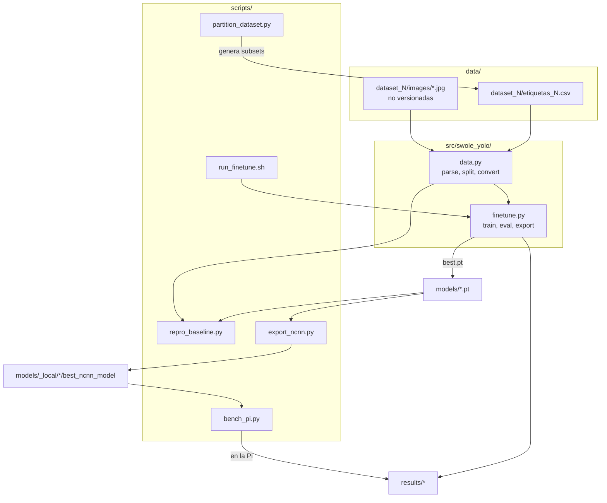

# Arquitectura del código

Mapa del repositorio y del flujo de datos. Para el *por qué* de cada decisión, lee antes los capítulos de la [guía](../guia/index.md).

## Vista general



## `src/swole_yolo/data.py`

| Función | Qué hace | Capítulo |
| --- | --- | --- |
| `parse_target(text)` | convierte la columna `Target` en una lista de cajas `{class_id, cx, cy, w, h, angle}`; valida clases 1–9 y dimensiones positivas; el ángulo se normaliza a [0, 360) | [6](../guia/06-datos.md) |
| `load_rows(csv, img_dir)` | une CSV e imágenes; falla si falta alguna; deriva `clip_id = Id.rsplit("_", 1)[0]` | 6 |
| `clip_level_indices(rows, val_ratio, test_ratio, seed)` | split por clips completos | 6 |
| `obb_corners_normalized(box, w, h)` | ecuación (1) del paper + normalización + recorte a [0,1] | [4](../guia/04-cajas-orientadas.md) |
| `build_yolo_dataset(rows, splits, dest)` | crea `images/{split}` (symlinks), `labels/{split}` y `data.yaml` | 4, 6 |

Constantes: `CLASS_NAMES` (9 clases, orden = id YOLO) y `NUM_CLASSES`.

## `src/swole_yolo/finetune.py`

Flujo de `experiment(args, dataset_size, output_dir)`:

1. `load_rows` → `clip_level_indices` con semilla `args.seed + dataset_size`.
2. `build_yolo_dataset` (omitible con `--skip-convert`).
3. `YOLO(args.model).train(...)`: el fine-tuning (ver [hiperparámetros reales](../guia/05-yolo11.md#55-hiperparametros-reales-de-nuestros-runs)).
4. `best_model.val(split="test")`: **única** evaluación sobre test, con el mejor checkpoint (selección por *fitness* de validación).
5. `benchmark_cpu(...)`: latencia en CPU de escritorio (**solo proxy**, 30 imágenes; no es la medición de la Pi).
6. `best_model.export(...)` a ONNX y NCNN.
7. Escribe `result_dataset_<n>.json`; al final `write_summary` produce `experiment_summary.csv` y `paper_experiment_summary.md`.

## Scripts

| Script | Uso |
| --- | --- |
| `repro_baseline.py` | re-evalúa los 6 checkpoints en su test y compara con los JSON guardados → `results/baseline_repro.json` |
| `bench_pi.py` | benchmark NCNN con metadatos completos (corre **en la Pi**) |
| `export_ncnn.py` | regenera NCNN/ONNX desde `models/*.pt` |
| `run_finetune.sh` | instala dependencias y lanza el entrenamiento en un VPS |
| `partition_dataset.py` | genera los subconjuntos 1 000…3 000 desde el `train.csv` completo. **Rutas de Windows sin parametrizar** |

## Datos y artefactos

```text
data/dataset_{1000,1500,2000,2500,3000}/etiquetas_N.csv   (versionado)
data/dataset_*/images/*.jpg                               (NO versionado)
models/ds{N}_{epocas}ep_{imgsz}px.pt                       (6 checkpoints del paper)
models/_local/                                            (derivados; ignorado por git)
results/finetune_50ep_544px/   result_dataset_N.json, experiment_summary.csv, runs/*/{args.yaml,results.csv}
results/finetune_70ep_640px/   ídem para el modelo de 640 px
results/pi_original_lost_script/   medidas originales de la Pi (script perdido)
results/baseline_repro.json    verificación de reproducibilidad
archive/                       experimentos previos, fuera del camino principal
```

!!! note "Qué NO está aquí"
    - El `train.csv` completo de Kaggle (54 263 imágenes) y, por tanto, la posibilidad de regenerar los subconjuntos.
    - El log del entrenamiento (qué optimizador eligió `auto`).
    - El script original de benchmark de la Pi.
